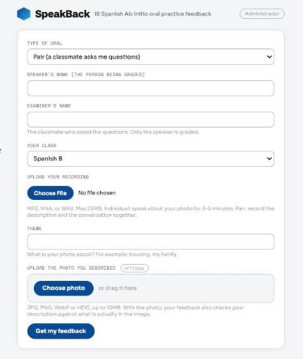

# SpeakBack

IB Spanish (Ab Initio and B) Individual Oral practice feedback — students upload a recording of
themselves describing a photo plus, optionally, the photo itself, and get back rubric-based
feedback generated against a teacher-calibrated rubric. Two formats are supported:

- **Individual** — one student describes the photo alone. Scored on Criterion A (/12) + B1 (/6) = /18.
- **Pair** — one student is the speaker and a classmate acts as the examiner, so a conversation
  follows the description. Only the speaker is graded, on A + B1 + B2 + C = /30 (marks only, no
  bands, no IB grade 1–7). A weak peer examiner never lowers the speaker's marks.

**Live:** https://speakback-294821507086.asia-southeast1.run.app



## How it works

1. A student picks their class (Spanish Ab Initio or Spanish B) and the type of oral
   (Individual or Pair), enters their name (and the examiner's name for a pair), a theme (e.g.
   "housing"), uploads an audio recording (MP3/M4A/WAV, up to 25MB), and optionally uploads the
   photo (JPG/PNG/WebP/HEIC, up to 10MB). The class and type choose which rubric is used.
2. If a photo was uploaded, Gemini first reads it on its own — what is visible, any legible text,
   cultural cues, what is ambiguous — so every later step judges against the same objective
   picture. The recording is then graded twice (once from the audio, once from a transcript) and a
   judge reconciles the two against the chosen rubric. In pair mode the transcript is labelled
   Speaker/Examiner, and the pipeline also checks how many voices it heard and flags a mismatch
   with the selected type for the teacher. Audio and photo only live in memory for the
   duration of the request; neither is ever written to disk.
3. The student gets back:
   - Strengths and successes, with specific examples.
   - Targeted corrections (error → why → correction).
   - Rubric-based scoring, as marks only (never bands). Individual: Criterion A (/12) and B1 (/6),
     subtotal /18; Conversation (B2) and Interaction (C) are not assessed. Pair: A, B1, B2 and C,
     total /30. No IB grade is ever given.
   - Actionable, prioritized recommendations tied to their actual gaps.
   - A check for use of the taught phrase banks / "Describir la Foto" framework.
   - A **Download PDF** button that opens the browser's print dialog (choose "Save as PDF"); a
     compact print stylesheet keeps the result short and the text selectable.
4. Every submission (transcript + feedback + theme + type) is saved to Firestore so teachers can
   review them in the admin dashboard, filtering by class, type (Individual/Pair) and theme, and
   deleting a submission if needed. The student also sees their own transcript, collapsed, with a
   note that AI speech recognition may make mistakes.

> This tool is for practice only — it does not represent or influence a student's official
> teacher-assigned grade.

## Stack

- **Server:** Node.js + Express, audio handled in-memory via Multer (never persisted to disk)
- **Grading:** Google Gemini (`@google/generative-ai`), audio input + structured JSON output
- **Database:** Google Cloud Firestore (collection `submissions`)
- **Frontend:** static HTML/CSS/JS in `public/`
- **Hosting:** Google Cloud Run (project `speakback-gemini`, region `asia-southeast1`), secrets in Secret Manager

## Running locally

```bash
npm install
cp .env.example .env   # fill in GEMINI_API_KEY, ADMIN_*, etc.
gcloud auth application-default login   # once, so Firestore works locally
npm start
```

The app runs at `http://localhost:3000`. Admin dashboard is at `/admin`, gated by
`ADMIN_USER` / `ADMIN_PASSWORD` from `.env`.

### Environment variables

| Variable | Purpose |
|---|---|
| `GEMINI_API_KEY` | Google AI Studio API key |
| `GEMINI_MODEL` | Gemini model used for grading (must support audio input) |
| `ADMIN_USER` / `ADMIN_PASSWORD` | Login for `/admin` |
| `SESSION_SECRET` | Signs the admin session cookie |
| `FEEDBACK_MD_PATH`, `FEEDBACK_MD_PATH_SPANISH_B` | Paths to the solo rubrics (read fresh on every request) |
| `FEEDBACK_MD_PATH_PAIR`, `FEEDBACK_MD_PATH_PAIR_SPANISH_B` | Paths to the pair rubrics |
| `GOOGLE_CLOUD_PROJECT` | Google Cloud project that holds Firestore (`speakback-gemini`) |
| `PORT` | Server port (default 3000) |

## The rubrics

The rubric files are the actual grading logic — they are sent to the model with every submission,
not baked into the code. Each covers the Criterion descriptors, how to use the photo as evidence
(accuracy, coverage, grounded inference, cultural fit), performance-level differentiators adapted
from teacher-graded transcripts, and the study material taught in class.

| File | Used for |
|---|---|
| `feedback.md` | Ab Initio, Individual (A + B1, /18) |
| `feedback-spanish-b.md` | Spanish B, Individual (A + B1, /18) |
| `feedback-pair.md` | Ab Initio, Pair (A + B1 + B2 + C, /30) |
| `feedback-pair-spanish-b.md` | Spanish B, Pair (A + B1 + B2 + C, /30) |

The pair rubrics are new and not yet calibrated against real peer-examiner recordings. Rubric
files ship inside the container, so after editing one, redeploy to Cloud Run.

`feedback-full-exam.md` and `feedback-b-full-exam.md` are archived full-exam references. They are
not loaded at runtime.
